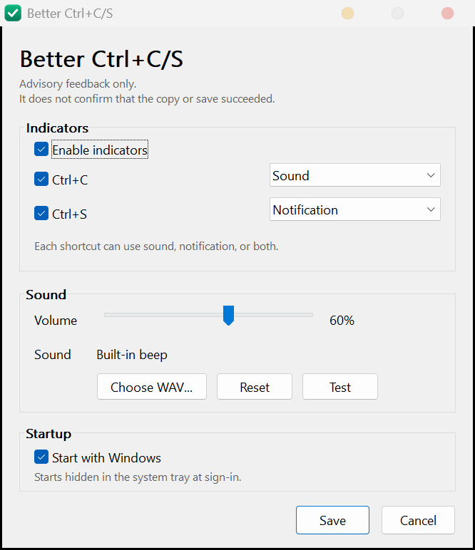

# Better Ctrl+C/S

A native Windows tray utility that acknowledges <kbd>Ctrl</kbd>+<kbd>C</kbd> and
<kbd>Ctrl</kbd>+<kbd>S</kbd> with a short sound, a small desktop notification, or
both. Single executable, no runtime, no network access.

> [!WARNING]
> **Feedback is not confirmation.**
>
> This program observes whether the key combination was pressed. It does not
> read the clipboard, inspect the target application, check the file system, or
> verify that a copy or save operation completed. A notification or sound means
> only that the shortcut was pressed while the program was running. It does not
> mean that data was copied or written. Likewise, a successful copy or save may
> produce no feedback at all.
>
> Copy and save operations can fail for reasons this program cannot observe,
> including application behavior, permissions, disk space, network failures,
> delayed writes, and programs that remap or ignore the shortcut.
>
> **To the maximum extent permitted by law, the author provides this software
> "as is", without warranty of any kind, and is not liable for any lost,
> corrupted, or unsaved data, or for any other damage arising from its use or
> misuse. Downloading, installing, or using this software constitutes acceptance
> of this disclaimer and the MIT License. If you do not accept these terms, do
> not use the software.**




## Features

- Global detection of <kbd>Ctrl</kbd>+<kbd>C</kbd> and <kbd>Ctrl</kbd>+<kbd>S</kbd>.
  The keys are always forwarded to the foreground application unchanged.
- Independent feedback per shortcut: sound, notification, sound + notification,
  or disabled.
- Built-in 880 Hz tone with volume control (0-100).
- Custom sound import (PCM WAV; normalized to 16-bit on import).
- Borderless notification that does not take focus. Text and display time are
  configurable.
- Tray menu with settings, a master enable switch, and exit.
- Per-user autostart at sign-in (enabled on first run; can be disabled).
- Single instance; settings and configuration live in `%APPDATA%\BetterCtrlCS`.
- No installer, no administrator rights, no service, no driver, no DLL
  injection, no telemetry.

The release build is approximately 100 KB and uses roughly 2.5 MB of private
memory at idle on the development system. Values vary with compiler and Windows
version.

## Requirements

- Windows 10 or Windows 11, x64.
- No additional runtime. The executable links against the Universal C Runtime
  included with Windows.

## Install

1. Download `BetterCtrlCS.exe` from the
   [latest release](https://github.com/MiCake233/Better-Ctrl-C-S/releases/latest).
2. Place it in a permanent, user-writable folder, for example
   `%LOCALAPPDATA%\Programs\BetterCtrlCS`.
3. Run the executable. On first run it creates the configuration, enables
   sign-in autostart, and opens the settings window.
4. Adjust the feedback settings and click **Save**.

The window close button hides the window; the program keeps running in the
notification area. Use the tray menu to open settings or exit.

Autostart is stored as a per-user registry value:

```
HKCU\Software\Microsoft\Windows\CurrentVersion\Run
    BetterCtrlCS = "<path>\BetterCtrlCS.exe" --background
```

If the executable is moved, start it once from the new location. It rewrites a
stale autostart path on startup.

## Uninstall

1. Open settings from the tray icon and clear **Start with Windows**.
2. Choose **Exit** from the tray menu.
3. Delete the executable.
4. Optionally delete `%APPDATA%\BetterCtrlCS` (configuration, custom sound, log).

## Usage

Defaults:

| Shortcut | Feedback |
| --- | --- |
| <kbd>Ctrl</kbd>+<kbd>C</kbd> | Sound |
| <kbd>Ctrl</kbd>+<kbd>S</kbd> | Notification |

The default notification text is localized: `保存成功` / `复制成功` on Chinese
Windows, `Saved` / `Copied` otherwise. Both strings can be overridden in the
configuration file.

Settings:

- **Enable indicators** is the master switch. It can also be toggled from the
  tray menu.
- **Ctrl+C** and **Ctrl+S** enable feedback for each shortcut independently and
  select its effect.
- **Volume** applies to both the built-in tone and custom WAV files.
- **Choose WAV...** imports a custom sound; **Reset** returns to the built-in
  tone; **Test** plays the current selection.
- **Start with Windows** manages the per-user autostart entry.

The notification is drawn near the lower-right corner of the work area of the
monitor that contains the foreground window. It never takes focus and ignores
mouse input.

## Configuration

Configuration is stored at
`%APPDATA%\BetterCtrlCS\config.ini` as UTF-8. The application rewrites the file
when settings are saved; manual edits take effect after the program is restarted.

```ini
[General]
Enabled=1
CtrlC=1
CtrlS=1
CtrlCFeedback=sound
CtrlSFeedback=notification

[Sound]
Volume=60
CustomSound=0

[Notification]
TextCopy=复制成功
TextSave=保存成功
DurationMs=1500
```

| Section | Key | Values | Default |
| --- | --- | --- | --- |
| General | `Enabled` | `0`, `1` | `1` |
| General | `CtrlC` | `0`, `1` | `1` |
| General | `CtrlS` | `0`, `1` | `1` |
| General | `CtrlCFeedback` | `sound`, `notification`, `both`, `none` | `sound` |
| General | `CtrlSFeedback` | `sound`, `notification`, `both`, `none` | `notification` |
| Sound | `Volume` | `0`-`100` | `60` |
| Sound | `CustomSound` | `0`, `1` | `0` |
| Notification | `TextCopy` | text, up to 95 characters | localized |
| Notification | `TextSave` | text, up to 95 characters | localized |
| Notification | `DurationMs` | `300`-`10000` | `1500` |

`CtrlCFeedback=none` is equivalent to `CtrlC=0`. Boolean keys also accept
`true`/`false`, `yes`/`no`, and `on`/`off`.

## Custom sounds

Use **Choose WAV...** in the settings window. The importer accepts uncompressed
PCM WAV files that are mono or stereo, 8/16/24/32-bit, and no longer than
10 seconds or 16 MB. The file is converted to 16-bit PCM and copied to
`%APPDATA%\BetterCtrlCS\custom.wav`; the original file is not referenced again.

To use another format, convert it to PCM WAV first, for example with FFmpeg:

```powershell
ffmpeg -i input.mp3 -ac 2 -ar 44100 -c:a pcm_s16le output.wav
```

## How it works

- A `WH_KEYBOARD_LL` hook is installed by the non-elevated process. It watches
  for `WM_KEYDOWN` events for `C` or `S` while `Ctrl` is held and `Alt` is not.
  Auto-repeat is suppressed per physical key press.
- The hook callback only posts a message to the application thread and then
  calls `CallNextHookEx`. It never consumes or modifies input.
- The application thread plays a pre-built in-memory WAV buffer with
  `PlaySound(SND_MEMORY | SND_ASYNC)` and, if enabled, shows a layered
  `WS_EX_NOACTIVATE` window for the configured duration.
- Custom WAV files are validated and normalized when imported. Configuration
  writes are atomic. A named mutex enforces one instance per user session.
- Autostart uses the per-user `Run` key; no scheduled task or service is
  created.

The source is organized as follows:

| File | Purpose |
| --- | --- |
| `src/main.c` | startup, keyboard hook, tray icon, message loop, autostart |
| `src/config.c` | UTF-8 INI parser and writer |
| `src/audio.c` | tone generation, WAV parsing and normalization, playback |
| `src/notify.c` | non-activating notification window |
| `src/settings.c` | settings window |
| `src/util.c` | paths, files, UTF conversions, logging, registry helpers |

## Security and privacy

- No network access, telemetry, update check, or remote configuration.
- The clipboard is never read or written.
- File contents are not inspected; only the configuration, an imported WAV, and
  a small error log are accessed.
- The executable requests no elevation and runs with the current user's
  privileges (`asInvoker`). It does not install a service, driver, or shell
  extension, and does not inject code into other processes.
- The global keyboard hook is the only input integration. It forwards every
  event and records no keystrokes.
- The log at `%APPDATA%\BetterCtrlCS\BetterCtrlCS.log` contains startup and
  error messages only. It is capped at 256 KB.
- Release binaries are not code-signed. Because global keyboard hooks and
  autostart entries are also used by keyloggers, heuristic antivirus software
  may warn. The full source and build scripts are provided; if that is a
  concern, build the executable yourself.

## Limitations

- The program cannot verify that a copy or save succeeded. This is the central
  limitation and the reason for the disclaimer above.
- Keys pressed on the secure desktop (UAC prompts, lock screen) are not
  observed. Behavior with elevated applications and security software varies.
- Applications that remap or implement their own handling of these shortcuts
  may behave differently.
- Autostart is per user and starts at sign-in, not before sign-in.
- Moving the executable requires one launch from the new location to repair the
  autostart entry.
- Custom audio is limited to PCM WAV; compressed formats are not decoded.
- The interface and documentation are in English; only the default notification
  text follows the Windows display language.
- The build targets x64 Windows 10/11. The source is plain Win32 C and can be
  ported, but only this configuration is tested.

## Building

Prerequisites:

- MinGW-w64 toolchain for x86_64 with UCRT (tested with GCC 16.1.0 and
  `windres`).
- `gcc` and `windres` available in `PATH`.

Build:

```bat
build.bat
```

The output is `build\BetterCtrlCS.exe`.

The build compiles `src/manifest_stub.c` as `build/default-manifest.o` and adds
`-B build` to the link. This prevents the MinGW-w64 GCC driver from appending a
second, implicit `RT_MANIFEST` resource, which otherwise causes the linker to
report `.rsrc merge failure: multiple non-default manifests`.

GitHub Actions builds the same way on `windows-latest` with MSYS2 UCRT64. The
workflow is in `.github/workflows/build.yml` and uploads the executable as a
workflow artifact.

`scripts/make_icon.py` regenerates `resources/app.ico` and `assets/logo.png`
from code. It requires Python 3 and Pillow and is not needed for a normal build.

## License

MIT License. See [LICENSE](LICENSE).

The disclaimer at the top of this document is part of the terms of use. By
downloading, installing, or using this software, you accept that disclaimer and
the MIT License. The software is provided without warranty; the author is not
liable for data loss or any other damage resulting from its use.
